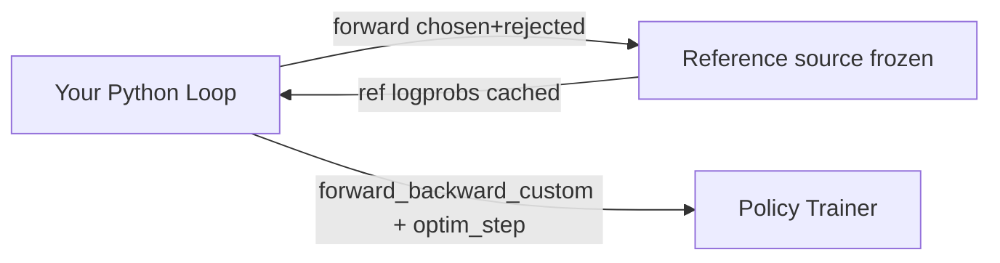

Run Direct Preference Optimization (DPO) on Fireworks with the Training API cookbook recipe, using pairwise preference data and configurable reference models.

## What this is

This guide walks through DPO (Direct Preference Optimization) training using the cookbook. DPO learns from preference pairs (chosen vs. rejected responses) without a separate reward model.

## How DPO differs from GRPO

| | DPO | GRPO |
| - | - | - |
| **Trainer jobs** | 1 for LoRA, 2 for full-parameter (policy + frozen reference) | 1 policy trainer plus an inference deployment in the default cookbook loop |
| **Data** | Preference pairs (chosen/rejected) | Prompts + reward function |
| **Reference logprobs** | Frozen scores cached and reused | No reference in the default loop |
| **Loss** | `-log(sigmoid(beta * margin))` | Clipped policy gradient on group-relative advantages |

## Architecture



## Using the recipe

```python theme={null}
from training.recipes.dpo_loop import Config, main
from training.utils import TrainerConfig, WandBConfig

cfg = Config(
    log_path="./dpo_logs",
    base_model="accounts/fireworks/models/qwen3-8b",
    dataset="/path/to/preference_data.jsonl",
    tokenizer_model="Qwen/Qwen3-8B",
    beta=0.1,
    epochs=1,
    batch_size=4,
    max_seq_len=4096,
    trainer=TrainerConfig(
        training_shape_id="accounts/fireworks/trainingShapes/qwen3-8b-128k",
    ),
    wandb=WandBConfig(entity="my-team", project="dpo-experiment"),
)

main(cfg)
```

## Dataset format

DPO expects preference pairs. Supported formats:

**Format 1 — chosen/rejected messages:**

```json theme={null}
{
  "chosen": {"messages": [{"role": "user", "content": "..."}, {"role": "assistant", "content": "good response"}]},
  "rejected": {"messages": [{"role": "user", "content": "..."}, {"role": "assistant", "content": "bad response"}]}
}
```

**Format 2 — input/output split:**

```json theme={null}
{
  "input": {"messages": [{"role": "user", "content": "..."}]},
  "preferred_output": [{"role": "assistant", "content": "good"}],
  "non_preferred_output": [{"role": "assistant", "content": "bad"}]
}
```

## Loss and reference

DPO increases the chosen-versus-rejected policy margin relative to a frozen
reference. It trains with `-log(sigmoid(beta * margin))`, using summed logprobs
over the response tokens. Reference scores are cached and reused; keep the base
model, tokenizer, and rendering consistent with that cache.

LoRA DPO normally shares a frozen reference within the policy trainer.
Full-parameter DPO uses a separate reference trainer. DPO and ORPO retain
controlled dataset batches and need no rollout streaming. Loss and cache
implementation details live in the [recipe](https://github.com/fw-ai/cookbook/blob/main/training/recipes/dpo_loop.py)
and [training skill](https://github.com/fw-ai/cookbook/blob/main/skills/fireworks-training/references/sdk-recipes.md).

## Operational guidance

* **Set `trainer.training_shape_id` when you need an explicit policy shape** — otherwise supported recipes auto-select a validated policy shape.
* **Leave `trainer.reference_training_shape_id` unset unless you need a specific reference shape** — full-parameter DPO auto-selects the model's validated LoRA shape as the reference; LoRA DPO uses a shared-session reference by default.
* **DPO does not provision a deployment** — there are no rollout samples or deployment weight syncs in the recipe.
* **Keep a versioned reference cache** tied to tokenizer + base model revision. If the base model changes, recompute reference logprobs.
* **Monitor margin statistics**: increasing margins indicate the policy is learning preferences.
* **Periodic checkpoints are disabled by default** (`dcp_save_interval=0`); successful runs save final state by default. Set a positive interval on `dpo_loop.Config` for recovery during a run.

## Common pitfalls

* **Mismatched formatting** between chosen/rejected sequences corrupts preference signals — ensure identical prompt prefixes.
* **Stale reference cache**: If you warm-start from a different model, cached reference logprobs are invalid.

## Related preference methods

* **ORPO** (`training.recipes.orpo_loop`) — Odds Ratio Preference Optimization. Combines an SFT-style negative-log-likelihood term on the chosen response with a margin term on the odds ratio between chosen and rejected. Unlike DPO, ORPO does **not** require a reference trainer (no cached reference logprobs), so the recipe runs with a single trainer + dataset of preference pairs. See `training.recipes.orpo_loop` in the public [cookbook repo](https://github.com/fw-ai/cookbook/blob/main/training/recipes/orpo_loop.py) for the full configuration.

## Related guides

* [Cookbook RL (GRPO)](/fine-tuning/training-api/cookbook/rl) — reinforcement learning recipes
* [Cookbook Reference](/fine-tuning/training-api/cookbook/reference) — all config classes
* [Loss Functions](/fine-tuning/training-api/dedicated#loss-functions) — API-level DPO loss details
