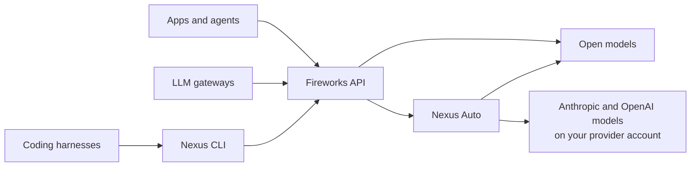

Nexus brings Fireworks open models and Nexus Auto into Claude Code, ChatGPT, and the other AI tools your team already uses, with provider keys and spend limits for admins.

> **[Connect your tool in a few minutes](/nexus/quickstart)**
>
> Pick Claude Code, ChatGPT, Cursor, or another harness and follow its setup.

## Who Nexus is for

> **Developers**
>
> Keep Claude Code, ChatGPT, Codex, Cursor, or VS Code. Run one command, and Fireworks open models show up in your model picker next to the models you use today. Turn it off with one command to get your original settings back.

> **Team admins**
>
> Connect your Anthropic, OpenAI, or Amazon Bedrock account once for the whole team. Cap each person's spend on Fireworks models and see usage by model and by user.

## What you get

> **[Nexus CLI](/nexus/cli)**
>
> One command connects a coding harness to Fireworks and restores it when you are done.

> **[Nexus Auto](/nexus/auto)**
>
> One model ID, `auto`. Easy turns run on open models, and harder turns go to an Anthropic or OpenAI model on your own account.

> **[Open models](/nexus/open-models)**
>
> GLM, Kimi, DeepSeek, and other open models on Fireworks serverless, billed per token.

> **[Harness support](/nexus/harnesses)**
>
> Setup and answers for Claude Code, ChatGPT, Codex, Claude Desktop, Cursor, VS Code, OpenCode, Pi, Copilot, and DeepSeek Harness.

> **[Model providers](/nexus/provider-keys)**
>
> Store Anthropic, OpenAI, or Amazon Bedrock credentials once so developers only need a Fireworks key.

> **[Spend limits](/nexus/usage-limits)**
>
> Set an account default, group limits, and per-user caps on Fireworks serverless spend.

## How Nexus fits together

Your tool connects through Nexus CLI, an SDK, or an LLM gateway. Every request then goes to one Fireworks model, or to Nexus Auto, which picks the model for each turn.

Building your own agent or running a gateway instead of a harness? See [APIs and SDKs](/nexus/apis-and-sdks) or [LLM Gateways](/nexus/llm-gateways).
