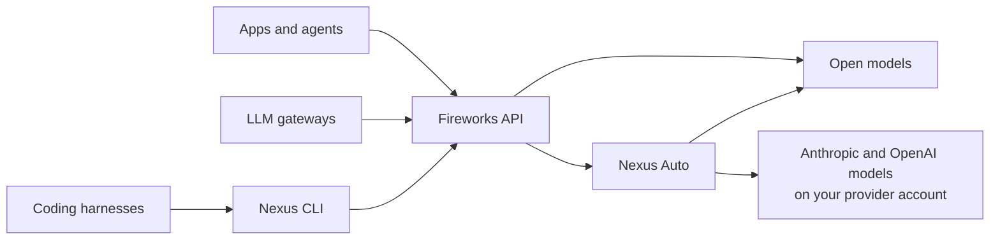

Use Nexus Auto in Claude Code, ChatGPT, Codex, and the tools you already use. Every task gets the right model, open or closed, at the lowest cost.

> [card] [Connect your tool](/nexus/quickstart)
>
> Choose Claude Code, ChatGPT, Cursor IDE, or another harness, and follow its setup steps.

## Who Nexus is for

* **Developers:** a Nexus CLI command adds Nexus Auto to your tool's model picker next to the models you use today. A second command restores your original settings.
* **Team admins:** connect an Anthropic, OpenAI, or Amazon Bedrock account once for the whole team, and view usage by model and by user. On Enterprise, admins can also cap each person's spend on Fireworks models.

Nexus has its own app at [nexus.fireworks.ai](https://nexus.fireworks.ai), with Pro, Team, and Enterprise [plans](/nexus/plans). A Nexus account is separate from a Fireworks platform account.

## How Nexus works

Your tool connects through [Nexus Desktop](/nexus/desktop), [Nexus CLI](/nexus/cli), an SDK, or an LLM gateway. By default, requests use [Nexus Auto](/nexus/auto) (`auto`), which picks a model for each turn: a Fireworks open model, or an Anthropic or OpenAI model on your own account if you've connected one. On Enterprise, you can also [choose a specific open model](/nexus/open-models).

To connect your own agent, use [APIs and SDKs](/nexus/apis-and-sdks). To connect a gateway, use [LLM Gateways](/nexus/llm-gateways).

Nexus components:

* [Nexus CLI](/nexus/cli): one command connects a coding harness to Fireworks. Another restores your settings when you're done.
* [Nexus Auto](/nexus/auto): one model ID, `auto`.
* [Open models](/nexus/open-models): Enterprise includes general access to GLM, Kimi, DeepSeek, and other open models on Fireworks serverless, billed per token.
* [Harness support](/nexus/harnesses): setup steps and answers for Claude Code, ChatGPT, Codex, Claude Desktop, Cursor IDE, VS Code, OpenCode, Pi, Copilot, and DeepSeek Harness.
* [Model providers](/nexus/provider-keys): store Anthropic, OpenAI, or Amazon Bedrock credentials once, so developers only need a Fireworks key.
* [Spend limits](/nexus/usage-limits): set an account default, group limits, and per-user caps on Fireworks serverless spend.
