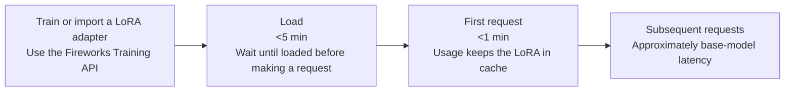

Serve your LoRA adapters on shared serverless GPUs, pay per token, and go from a dataset to a live adapter in three steps.

Preview

## How it works

Specialized Model Inference runs your LoRA adapters on Fireworks' shared serverless pool. You don't create or pay for a deployment. You load an adapter, call it like any serverless model, and pay per token at the base model's price.



## Supported models and limits

Adapters must be trained on a supported model:

| Model | Model ID | Max LoRA rank |
| - | - | - |
| GLM 5.3 Flash | `accounts/fireworks/models/glm-5p3-flash` | 64 |

Adapters load on this serverless base model:

| Serverless base model | Max adapters loaded at a time |
| - | - |
| GLM 5.3 Flash Multi-LoRA | 3 |

We plan to support more base models over time. Adapters trained on any other base model can't be loaded onto serverless - please use a [dedicated deployment](/fine-tuning/deploying-loras).

Each account can load up to 3 LoRA adapters per base model at a time. Loading a fourth returns `ResourceExhausted`. Unload an adapter to free up a slot. If you need more slots, contact [inquiries@fireworks.ai](mailto:inquiries@fireworks.ai) or your account team.

## Get started

Go from a dataset to a live adapter in three steps. You need firectl 1.8.15 or later.

> [accordion] Setup: install firectl, sign in and set your variables
>
> **1. Install or upgrade firectl**
>
> ```bash theme={null}
> firectl upgrade
> firectl version
> ```
>
> **2. Sign in**
>
> ```bash theme={null}
> firectl signin
> ```
>
> firectl acts on the account you sign in to. If you belong to more than one account, pass `-a <ACCOUNT_ID>` on each command, or check which account is active before loading anything.
>
> **3. Set your variables**
>
> Fill these in once. Every command below reads them.
>
> ```bash theme={null}
> export FIREWORKS_API_KEY="fw_..."        # an API key from the account that owns the adapter
> export ACCOUNT_ID="your-account-id"      # the account that owns the adapter
> ```
>
> The examples name the adapter `my-lora` and train it on GLM 5.3 Flash (`accounts/fireworks/models/glm-5p3-flash`). Replace `my-lora` with your adapter's ID wherever it appears.

### Step 1. Train a LoRA adapter on a supported model

Skip this step if you already have an adapter in the `READY` state on a [supported base model](#supported-models-and-limits).

> [tab] Serverless Training API
>
> Train on Fireworks' shared serverless trainer pool with the [Serverless Training API](/fine-tuning/training-api/serverless). You pay per token and don't provision a trainer.
>
> **1. Install the cookbook**
>
> ```bash theme={null}
> git clone https://github.com/fw-ai-external/cookbook
> pip install -e ./cookbook/training
> cd cookbook
> ```
>
> **2. Run serverless SFT**
>
> Save this as `train_my_lora.py` in the `cookbook` folder and point `dataset` at a chat-format JSONL file. `serverless=True` runs the job on the serverless trainer pool. `lora_rank` must be 64 or lower. When training finishes, `output_model_id` saves the adapter to your account as `my-lora`.
>
> ```python theme={null}
> from training.recipes import sft_loop
>
> if __name__ == "__main__":
>     sft_loop.main(sft_loop.Config(
>         serverless=True,
>         base_model="accounts/fireworks/models/glm-5p3-flash",
>         tokenizer_model="zai-org/GLM-5.3-Flash",
>         renderer_name="glm53_flash",
>         dataset="./train.jsonl",
>         lora_rank=16,
>         max_seq_len=4096,
>         epochs=3,
>         log_path="./my-lora-run",
>         output_model_id="my-lora",
>     ))
> ```
>
> ```bash theme={null}
> python train_my_lora.py
> ```
>
> **3. Check the adapter**
>
> ```bash theme={null}
> firectl model get my-lora
> ```
>
> The adapter is ready to load when its state is `READY`.

> [tab] Import an adapter
>
> If you trained an adapter elsewhere, import it as a Hugging Face PEFT folder. The folder needs `adapter_config.json` and `adapter_model.safetensors`, and the rank must be between 4 and 64.
>
> ```bash theme={null}
> firectl model create my-lora ./my_adapter/ \
>   --base-model accounts/fireworks/models/glm-5p3-flash
> ```

### Step 2. Deploy it on serverless

> [tab] firectl
>
> ```bash theme={null}
> firectl model load-lora my-lora --serverless --wait
> ```
>
> Loading takes under 5 minutes. When it's done you'll see:
>
> ```plain text theme={null}
> LoRA model loaded successfully; the first request downloads the adapter and may be slower
> ```
>
> Check what's loaded, on serverless and on any dedicated deployments:
>
> ```bash theme={null}
> firectl deployed-model list
> ```
>
> ```plain text theme={null}
> NAME                                                 MODEL                               SERVERLESS  STATE      DEFAULT
> accounts/my-account/deployedModels/my-lora-hnywzke6  accounts/my-account/models/my-lora  true        DEPLOYED   true
> ```
>
> `firectl model get my-lora` shows the same copies under **Deployed Model Refs**. A trained adapter with no refs is `READY` but not loaded, and calls to it return `404`.
>
> A copy can sit in `DEPLOYING` until it receives its first request. If the state hasn't moved after the load command returned, send one request; the first call completes the load.

> [tab] REST
>
> ```bash theme={null}
> curl -X POST "https://api.fireworks.ai/v1/accounts/$ACCOUNT_ID/deployedModels" \
>   -H "Authorization: Bearer $FIREWORKS_API_KEY" \
>   -H "Content-Type: application/json" \
>   -d "{\"model\": \"accounts/$ACCOUNT_ID/models/my-lora\", \"serverless\": true}"
> ```
>
> The response includes the deployed model's ID. Save it, because you need it to unload over REST.

### Step 3. Call the serverless endpoint

Send the same prompt to the base model and to the adapter, and compare the two replies. The example needs [jq](https://jqlang.org).

```bash theme={null}
PROMPT="paste a held-out example from your dataset here"
for MODEL in accounts/fireworks/models/glm-5p3-flash accounts/$ACCOUNT_ID/models/my-lora; do
  echo "== $MODEL"
  curl -sS --fail-with-body https://api.fireworks.ai/inference/v1/chat/completions \
    -H "Authorization: Bearer $FIREWORKS_API_KEY" \
    -H "Content-Type: application/json" \
    -d "$(jq -n --arg m "$MODEL" --arg p "$PROMPT" \
      '{model: $m, messages: [{role: "user", content: $p}], max_tokens: 300, reasoning_effort: "low"}')" \
    | jq -r '.choices[0].message.content // .'
done
```

> [!NOTE]
>
> GLM 5.3 Flash is a reasoning model and thinks at maximum effort unless you set `reasoning_effort`. Without it, a 300-token cap can be used up by the hidden reasoning and `content` comes back empty. Set `reasoning_effort` to `low` for an adapter trained on short answers, or raise `max_tokens`.

The first request after loading a LoRA adapter can take up to a minute. Later requests have much lower latency. See [Latency](#latency).

#### Which model string to use

There is no `#serverless` suffix. Use one of these:

| `model` string | Goes to |
| - | - |
| `accounts/<ACCOUNT_ID>/models/<LORA_ID>` (or the short form `<ACCOUNT_ID>/<LORA_ID>`) | The default copy. The first copy you load becomes the default, whether it is serverless or dedicated. Change it with `firectl deployed-model update <DEPLOYED_MODEL_ID> --default`. |
| `accounts/<ACCOUNT_ID>/deployedModels/<DEPLOYED_MODEL_ID>` | That specific copy. Use this when the adapter is loaded on both serverless and a dedicated deployment. |
| `accounts/<ACCOUNT_ID>/models/<LORA_ID>#accounts/<ACCOUNT_ID>/deployments/<DEPLOYMENT_ID>` | Always that dedicated deployment. `accounts/<ACCOUNT_ID>/models/<LORA_ID>#<ACCOUNT_ID>/<DEPLOYMENT_ID>` is the short form. |

### Clean up: unload the adapter

Unloading frees one of your account's 3 adapter slots for that base model. firectl takes the adapter ID; REST takes the deployed model ID.

> [tab] firectl
>
> ```bash theme={null}
> firectl model unload-lora my-lora --serverless --wait
> ```
>
> `--wait` returns once the adapter is fully unloaded. Without it, the command returns right away and calls to the adapter can keep succeeding for a short time.

> [tab] REST
>
> REST unloads by the deployed model's ID, not the adapter's ID. If you didn't save it from the load response, look it up (this needs [jq](https://jqlang.org)):
>
> ```bash theme={null}
> DEPLOYED_MODEL_ID=$(curl -s "https://api.fireworks.ai/v1/accounts/$ACCOUNT_ID/deployedModels" \
>   -H "Authorization: Bearer $FIREWORKS_API_KEY" |
>   jq -r --arg m "accounts/$ACCOUNT_ID/models/my-lora" \
>     '.deployedModels[] | select(.model == $m and .serverless == true) | .name | split("/") | last')
> echo "$DEPLOYED_MODEL_ID"
> ```
>
> Then unload it:
>
> ```bash theme={null}
> curl -X DELETE "https://api.fireworks.ai/v1/accounts/$ACCOUNT_ID/deployedModels/$DEPLOYED_MODEL_ID" \
>   -H "Authorization: Bearer $FIREWORKS_API_KEY"
> ```

## Try a public adapter

Fireworks keeps a public adapter loaded on serverless. Any account can call it with an API key, and you don't need to load it. `accounts/fireworks/models/glm5p3-flash-us-caveman-lora` is a rank-64 adapter on GLM 5.3 Flash, trained to answer in as few words as possible.

> [tab] curl
>
> ```bash theme={null}
> PROMPT="Facts: Order #4821 shipped on May 3 via UPS. Expected delivery is May 7. The package weighs 2.4 kg. Question: When will my order arrive?"
> for MODEL in accounts/fireworks/models/glm5p3-flash-us-caveman-lora accounts/fireworks/models/glm-5p3-flash; do
>   echo "== $MODEL"
>   curl -sS --fail-with-body https://api.fireworks.ai/inference/v1/chat/completions \
>     -H "Authorization: Bearer $FIREWORKS_API_KEY" \
>     -H "Content-Type: application/json" \
>     -d "$(jq -n --arg m "$MODEL" --arg p "$PROMPT" \
>       '{model: $m, messages: [{role: "user", content: $p}], max_tokens: 300, reasoning_effort: "low"}')" \
>     | jq -r '.choices[0].message.content // .'
> done
> ```
>
> The example needs [jq](https://jqlang.org).

> [tab] Python (OpenAI client)
>
> ```python theme={null}
> import os
> from openai import OpenAI
>
> client = OpenAI(
>     base_url="https://api.fireworks.ai/inference/v1",
>     api_key=os.environ["FIREWORKS_API_KEY"],
>     timeout=300,
> )
>
> prompt = [{
>     "role": "user",
>     "content": "Facts: Order #4821 shipped on May 3 via UPS. Expected delivery is May 7. "
>     "The package weighs 2.4 kg. Question: When will my order arrive?",
> }]
> for model in (
>     "accounts/fireworks/models/glm5p3-flash-us-caveman-lora",
>     "accounts/fireworks/models/glm-5p3-flash",
> ):
>     response = client.chat.completions.create(
>         model=model,
>         messages=prompt,
>         max_tokens=300,
>         reasoning_effort="low",
>     )
>     print(f"== {model}\n{response.choices[0].message.content}")
> ```

```plain text theme={null}
== accounts/fireworks/models/glm5p3-flash-us-caveman-lora
May 7.
== accounts/fireworks/models/glm-5p3-flash
Your order #4821 is expected to arrive on **May 7**. It shipped on May 3 via UPS.
```

The base model's wording varies from run to run. If the adapter has been idle, its first reply can take a few extra seconds while it loads back onto a GPU.

## Serverless or dedicated?

| Use serverless when | Use a [dedicated deployment](/fine-tuning/deploying-loras#multi-lora-deployment) when |
| - | - |
| You're experimenting or traffic is spiky | Traffic is steady and heavy enough that GPU-hour billing is cheaper |
| You have a few adapters | You serve many adapters with constant traffic |
| A slower first request is acceptable | You need consistent latency, isolated GPUs or a specific region |
| Small numeric differences from training are acceptable | You need higher-precision serving. See [Quality](#quality) |

## Pricing

You pay per token at the base model's [serverless price](/serverless/pricing), for the tokens the adapter processes. There is no charge for loading an adapter, for keeping it loaded, or for the time it sits idle. Training is billed separately by the training product you used.

| Base model | Input | Cached input | Output |
| - | - | - | - |
| GLM 5.3 Flash | \$0.15 / 1M tokens | \$0.03 / 1M tokens | \$0.50 / 1M tokens |

## Performance

### Latency

* **Loading** takes under 5 minutes.
* **The first request** after loading a LoRA adapter downloads it onto a GPU and can take up to a minute. Set the client timeout to at least 300 seconds.
* **Later requests** have much lower latency, about the base model's speed.

There are no latency guarantees during the preview. If you need consistent latency, use a [dedicated deployment](/fine-tuning/deploying-loras#multi-lora-deployment).

### Rate limits

Adapter traffic has its own rate limit, separate from base-model traffic, with the same quota as the GLM 5.3 Flash [serverless rate limits](/serverless/rate-limits). When you exceed it, requests return `429`. Retry with exponential backoff.

### Quality

Training is run at a higher numeric precision than serving. On serverless, the model may be quantized to improve performance. Fireworks runs rigorous tests on quality and we also recommend that users evaluate task-level metrics on a sufficiently large held-out set. If you need higher-precision serving, please use a [dedicated deployment](/fine-tuning/deploying-loras).

### Observability

You can see traffic split by LoRA adapter on the **Serverless** tab of the [Fireworks dashboard](https://app.fireworks.ai/dashboard/serverless).


### Access and privacy

* Only the account that owns an adapter can call it. Other accounts get `404`. Public adapters, like the [one above](#try-a-public-adapter), are the exception.
* Your adapters run on GPUs shared with other customers' adapters.
* Model-access policies apply through the base model: allowing a base model allows its adapters, and blocking it blocks them.

## Troubleshooting

| You see | Usual cause | What to do |
| - | - | - |
| `404` on a call | The adapter is `READY` but not loaded, the key belongs to another account, or the ID is misspelled | `firectl model get <LORA_ID>` and look for **Deployed Model Refs**; load it if there are none |
| `404` from another account | Only the owning account can call an adapter | Call it from the account that owns it |
| `ResourceExhausted` or `429` on load | Your account already has 3 adapters loaded on that base model | Unload one, or ask for more slots |
| `429` on a call | Adapter [rate limit](#rate-limits) for GLM 5.3 Flash | Retry with exponential backoff |
| Client timeout on the first call | The first request downloads the adapter, which can take up to a minute | Raise the client timeout to 300 s and retry |
| Empty `content` with a normal `usage` | Hidden reasoning used the token budget | Set `reasoning_effort` to `low` or raise `max_tokens` |
| State stays `DEPLOYING` | The copy is waiting for its first request | Send one request |
| Log probabilities or outputs differ slightly from training or evaluation | Training runs at a higher precision than serving | This is expected. Compare task-level metrics. See [Quality](#quality) |
| `400` on load | Rank above 64, unsupported base model, or both or neither of `serverless` and `deployment` set | Check the adapter's base model and rank |

## Next steps

> [card] [API reference](/api-reference/specialized-model-inference/overview)
>
> Load, list, get and unload adapters over REST

> [card] [Multi-LoRA on dedicated](/fine-tuning/deploying-loras#multi-lora-deployment)
>
> When serverless stops being the right fit
