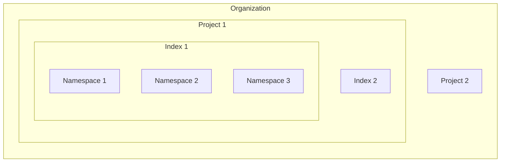

Learn how Pinecone is built, from organizations, projects, indexes, and namespaces down to the APIs and infrastructure that store and serve your data.

Pinecone's architecture has two layers: the resource hierarchy that organizes your data, and the serverless infrastructure that stores and serves it.

## Resource hierarchy

Your data in Pinecone is organized as a hierarchy of resources. An [organization](/guides/get-started/key-terms#organization) contains [projects](/guides/get-started/key-terms#project), a project contains [indexes](/guides/get-started/key-terms#index), and an index is divided into [namespaces](/guides/get-started/key-terms#namespace) that hold your [documents](/guides/get-started/key-terms#document) or [records](/guides/get-started/key-terms#record). For a definition of each object, see [Key terms](/guides/get-started/key-terms).

This diagram shows an organization with two projects. The first project holds two indexes, and the first index is divided into three namespaces:

## Serverless infrastructure

Pinecone runs as a managed service on AWS, GCP, and Azure. When you send a request to Pinecone, it goes through an [API gateway](#api-gateway) that routes it to either a global [control plane](#control-plane) or a regional [data plane](#data-plane). All your data is stored in distributed [object storage](#object-storage).

This diagram shows how the API gateway routes your application's requests to the control plane or to the data plane in your index's cloud region:

### API gateway

Every request to Pinecone includes an [API key](/admin/projects/manage-api-keys) that's assigned to a specific [project](/admin/projects/projects-overview). The API gateway first checks that your API key has access to the project. Then it routes your request to the global control plane (for managing projects and indexes) or a regional data plane (for reading and writing data).

### Control plane

The global control plane manages resources like projects and indexes and tracks them in a dedicated database. It also handles billing and user management, and it coordinates operations across regions.

### Data plane

The data plane handles all requests to write and read data in [indexes](/guides/indexes/index-data-overview) within a specific [cloud region](/guides/indexes/index-configuration#cloud-regions). Each index is divided into one or more logical [namespaces](/guides/indexes/index-data-overview#namespaces), and every read and write targets one namespace.

Pinecone separates writes and reads into different paths, and each path scales independently with demand, so queries never slow down writes, and writes never slow down queries.

### Data-plane APIs

Each index is created for, and served by, one data-plane API. The Documents API serves document indexes and is the API to build on. The legacy Vectors API and legacy Records API serve legacy vector indexes and legacy integrated indexes, and they keep working.

| | Documents API | Legacy Vectors API | Legacy Records API |
| :- | :- | :- | :- |
| You write | JSON documents with your own fields | An ID, a vector, and metadata | An ID, a text field, and metadata |
| Who embeds | You, or Pinecone per field in the schema | You, outside Pinecone | Pinecone, with one model per index |
| Source text lives | In its own `string` field | In a separate store, or in metadata | In metadata |
| Search by | Full-text, vector, or text that Pinecone embeds | Vector | Text that Pinecone embeds |
| Configured by | Schema | Dimension and metric | Model and text field |
| Unit of data | [Document](/guides/get-started/key-terms#document) | [Record](/guides/get-started/key-terms#record) | Record |
| Index | Document index | Legacy vector index | Legacy integrated index |

To move data from a legacy index to a document index, see [Move to the Documents API](/guides/indexes/move-to-the-documents-api).

### Object storage

Pinecone stores each namespace's data in distributed object storage as immutable files called slabs. The [index builder](#index-builder) creates slabs and optimizes them for querying.

## Write path

This diagram shows the log writer recording a write request in the request log and passing the data to the index builder, which moves it from the memtable into a namespace's slabs:

### Request log

When you send a write request (to add, update, or delete data), the [data plane](#data-plane) first logs the request with a unique sequence number (LSN). The sequence number keeps operations in order and tracks the state of the index.

Pinecone then returns `200 OK`. Your write is durable at this point, and Pinecone processes it in the background.

### Index builder

The index builder writes your data and its sequence number to an in-memory structure called a memtable. For an update or delete, it also tracks how queries should handle the old version.

Periodically, the index builder moves data from the memtable into slabs in [object storage](#object-storage). Small slabs use lightweight indexing that needs few resources. As slabs grow, the index builder merges them into larger slabs with indexing that performs better at scale. Each slab gets indexing suited to its size, and the cost of heavier indexing is spread over the life of the namespace.

> [!NOTE]
>
> All reads check the memtable, so you can search data immediately after you write it, before it reaches object storage. For more details, see [Query executors](#query-executors).

## Read path

This diagram shows the query router merging recent data from the memtable with ranked results from the query executors, which fetch slabs from object storage when they aren't cached:

### Query routers

When you send a search query, the [data plane](#data-plane) first checks your request against system limits, such as [rate and object limits](/reference/api/database-limits). The query router then finds the slabs that hold relevant data and sends your query to their executors. It also searches the memtable for recent data that isn't in object storage yet.

### Query executors

Each query executor searches its assigned slabs and returns the most relevant candidates to the query router. If your query has a metadata filter, the executors exclude anything that doesn't match before finding the best matches.

Slabs are usually cached in memory or on local SSD, which keeps queries fast. If a slab isn't cached, because it's being read for the first time or hasn't been used recently, the executor fetches it from object storage and caches it.

The query router then merges the executors' results with the memtable results, removes duplicates, and returns the best matches.
