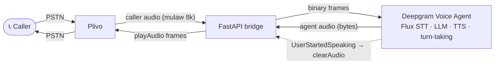

> For clean Markdown of any page, append .md to the page URL.
> For a complete documentation index, see https://developers.deepgram.com/llms.txt.
> For AI client integration (Claude Code, Cursor, etc.), connect to the MCP server at https://developers.deepgram.com/_mcp/server.

# Plivo and Deepgram Voice Agent

This guide builds a real-time phone agent. A caller dials a Plivo number, talks naturally, and has a conversation with an AI. The caller can interrupt the agent mid-sentence. The example also places outbound calls, and the agent hangs up when the conversation ends.

The setup is small. Plivo streams the call audio to your server. Your server passes that audio to the **Deepgram Voice Agent API**, a single WebSocket at `wss://agent.deepgram.com/v1/agent/converse`. It runs the whole conversation: speech-to-text, the language model, text-to-speech, and turn-taking. Flux, Deepgram's conversational speech-to-text, detects the end of each turn from the audio itself, so the bridge has no turn-taking logic of its own. By the end you have an agent that answers calls and places them.

## How the agent works

A voice agent repeats one loop: it hears audio, understands it, writes a reply, and speaks it. The loop has to be fast enough to feel like a conversation. The Voice Agent API runs that loop. Your server only moves audio between two sockets and reacts to one control signal, as the diagram shows.



The example runs one bridge per call. The bridge sends the caller's audio to the agent as binary frames. It sends the agent's audio to Plivo as `playAudio` messages. It also listens for one event, `UserStartedSpeaking`, which means the caller has interrupted. The Voice Agent API handles everything else.

## Before you begin

You need the following accounts, keys, and tools.

* A **Plivo** account. [Sign up](https://cx.plivo.com/signup) and you start with \$10 in free credit. You also need a [voice-enabled phone number](https://cx.plivo.com/phone-numbers), and the Auth ID and Auth Token from the [Plivo console](https://cx.plivo.com/home).
* A **Deepgram** API key. [Sign up free](https://console.deepgram.com/signup) and you start with \$200 in credit. This single key covers the whole agent.
* **Python 3.10** or later, [uv](https://docs.astral.sh/uv/), and Git 2.25 or later.
* A tunnel that gives your local server a public HTTPS URL, so Plivo can reach it: [`cloudflared`](https://developers.cloudflare.com/cloudflare-one/networks/connectors/cloudflare-tunnel/downloads/) or [ngrok](https://ngrok.com/download).

You don't need a separate LLM provider key. The Voice Agent can use OpenAI, Gemini, Anthropic, or another provider as its language model. Deepgram manages that connection and bills it through your Deepgram account.

Install one of the tunnel tools:

```bash
# macOS

# Option 1: cloudflared. The server starts the tunnel when you run it with --tunnel.
# No Cloudflare account is needed.
brew install cloudflared

# Option 2: ngrok. You start the tunnel and set PUBLIC_URL.
# Needs an authtoken from your ngrok account.
brew install ngrok
ngrok config add-authtoken <YOUR_NGROK_AUTHTOKEN>
```

A tunnel is for development and testing, not production. Once the agent works, deploy it on a host with a fixed HTTPS hostname. See [Go further](#go-further).

## Quick start

Three steps get you from a clone to a live call.

### 1. Set up the project

Clone the example's folder from [plivo/python-agents-examples](https://github.com/plivo/python-agents-examples/tree/main/deepgram-voiceagent). It holds the inbound and outbound servers.

```bash
git clone --depth 1 --filter=blob:none --sparse https://github.com/plivo/python-agents-examples.git
cd python-agents-examples
git sparse-checkout set deepgram-voiceagent
cd deepgram-voiceagent
cp .env.example .env                   # then fill in the four values below
```

The `.env` file needs four values. `PLIVO_PHONE_NUMBER` is the Plivo number the agent answers. Everything else has a default.

```bash
DEEPGRAM_API_KEY=...
PLIVO_AUTH_ID=...
PLIVO_AUTH_TOKEN=...
PLIVO_PHONE_NUMBER=+14150000001
```

`uv run` installs the dependencies the first time you start the server. The main ones are FastAPI, `websockets`, and the Plivo SDK. Speech-to-text, the language model, and text-to-speech all run inside the Voice Agent.

### 2. Start the server

Start the inbound server with a tunnel.

```bash
uv run python -m inbound.server --tunnel
```

> **Info**
>
> Prefer ngrok? Run `ngrok http 8000` in a second terminal. Set `PUBLIC_URL` in `.env` to the `https://` URL it prints, then start the server with `uv run python -m inbound.server`. A quick tunnel gets a new URL on every restart, and the server re-links your number each time.

On startup, the server:

1. Starts a Cloudflare quick tunnel and uses its `https://` URL as `PUBLIC_URL`.
2. Creates a Plivo application named `Deepgram_VoiceAgent`, or updates it, with `/answer` and `/hangup` on that URL as its Answer URL and Hangup URL.
3. Links `PLIVO_PHONE_NUMBER` to that application.
4. Logs a Ready line once Plivo has accepted the URL.

```text
Ready! Call +14150000001 to talk to the agent (Ctrl+C to stop)
```

> **Warning**
>
> Wait for the Ready line before you call. Plivo accepts a new tunnel hostname only after it resolves, which can take about a minute. The server retries until it does. Until then, your number isn't linked to the server.

### 3. Call the agent

Test the agent on a live call.

1. Call the number and listen for the greeting.
2. Ask a question and confirm you hear a spoken reply.
3. Talk over the agent mid-sentence. Confirm that the audio cuts off and the agent answers your new turn.
4. Watch the console. Each turn logs its transcript, then a completion line once the reply has finished playing. The greeting is turn 1, so your first question is turn 2:

   ```text
   [<call_uuid>] [  19.54s] [turn] turn 2: user 'What plans do you offer?'
   [<call_uuid>] [  20.56s] [turn] turn 2: agent 'We have three main plans: TechFlow Pro for twelve dollars a month with a hundred'
   [<call_uuid>] turn 2 complete
   ```

Every console line starts with a timestamp, the log level, and the source location. The log excerpts in this guide show only the message that follows. The timings and transcripts vary per call.

If the interruption test works, the bridge and the Voice Agent are working together.

## Build the integration

The quick start ran a finished bridge. This section builds it in seven steps. Follow the example's code, or use the steps to write your own bridge. Each step shows the code that does the work and a way to verify it. The code blocks are excerpts from `inbound/server.py` and `inbound/agent.py`, cut down to the important lines. The [full source](https://github.com/plivo/python-agents-examples/tree/main/deepgram-voiceagent) has the rest.

Each step uses one or two Plivo terms. The table lists them. The [Audio Streaming reference](https://www.plivo.com/docs/voice-agents/audio-streaming/concepts/audio-streaming-reference) documents every event.

| Plivo term        | Type             | What it does and where it is used                                                                                      |
| ----------------- | ---------------- | ---------------------------------------------------------------------------------------------------------------------- |
| Plivo application | Configuration    | Holds the Answer URL that Plivo requests when a call connects. Your number is linked to it. Used in Step 1.            |
| `<Stream>`        | XML element      | The Answer URL's response. Tells Plivo to stream the call audio to your WebSocket, in both directions. Used in Step 1. |
| `start`           | Event from Plivo | The first message on the WebSocket. Carries the `streamId` and `callId`. Used in Step 2.                               |
| `media`           | Event from Plivo | Carries the caller's audio to your server. Used in Step 2.                                                             |
| `playAudio`       | Event to Plivo   | Carries the agent's audio to the caller. Used in Step 4.                                                               |
| `clearAudio`      | Event to Plivo   | Drops audio Plivo has queued but not yet played. Used in Step 5.                                                       |
| `checkpoint`      | Event to Plivo   | A marker you place in the audio queue. Used in Step 6.                                                                 |
| `playedStream`    | Event from Plivo | Plivo's acknowledgement when playback reaches a checkpoint. Used in Step 6.                                            |

### Step 1: Answer the call with `<Stream>` XML

When a call connects, Plivo requests the application's Answer URL to ask your server what to do. You answer with XML. The key element is `<Stream>`. It opens a WebSocket from Plivo to your server and carries the call audio.

```python
@app.post("/answer", dependencies=[Depends(verify_plivo_signature)])
async def answer_webhook(request: Request, ...) -> Response:
    # ... read CallUUID, From and To from Plivo's request ...
    ws_url = stream_url(body_data)      # wss://<host>/ws?body=<base64 call metadata>

    response = plivoxml.ResponseElement()
    response.add(plivoxml.StreamElement(
        ws_url,
        bidirectional=True,
        keepCallAlive=True,
        contentType="audio/x-mulaw;rate=8000",
    ))
    return Response(content=response.to_string(), media_type="application/xml")
```

The XML Plivo receives:

```xml
<Response>
  <Stream bidirectional="true" keepCallAlive="true" contentType="audio/x-mulaw;rate=8000">wss://your-host/ws?body=...</Stream>
</Response>
```

`bidirectional="true"` makes barge-in possible. The agent's voice travels to Plivo on the same socket, so your server can also tell Plivo to stop playing it. `keepCallAlive="true"` keeps the call up while the stream is open. `contentType` sets the audio to μ-law at 8 kHz, the same format the agent asks Deepgram for in Step 3. The call's metadata travels as a base64 `body` query parameter on the WebSocket URL.

#### Link a number

The example creates the application and links your number on every start. To link a number manually, use the Plivo CLI, the Plivo Console, or the API. The Answer URL is `https://YOUR_HOST/answer` and the Hangup URL is `https://YOUR_HOST/hangup`, both with method **POST**.

#### Plivo CLI

[Install the CLI](https://www.plivo.com/docs/cli/install) and sign in once with `plivo login`. Create the application, then link the number to the `app_id` it returns.

```bash
plivo account applications create --app-name Deepgram_VoiceAgent \
  --answer-url https://YOUR_HOST/answer --answer-method POST \
  --hangup-url https://YOUR_HOST/hangup -o json

plivo numbers update 14150000001 --app-id <app_id>
plivo numbers get 14150000001 -o json      # "application" shows the link
```

#### Plivo Console

1. Go to **Voice → Applications** and click **Add New Application**.
2. Name it `Deepgram_VoiceAgent`, enter `https://YOUR_HOST/answer` as the Answer URL with method **POST**, and click **Create Application**.
3. On the **Phone Numbers** page, under **Your Numbers**, click your number.
4. In the **Number Configuration** box, set **Application Type** to **XML Application**, select `Deepgram_VoiceAgent`, and click **Update Number**.

#### Plivo API

Create the application with the [Application API](https://www.plivo.com/docs/account/api/application), then link the number with the [Numbers API](https://www.plivo.com/docs/numbers/account-phone-numbers#update-an-account-phone-number).

```bash
curl -X POST "https://api.plivo.com/v1/Account/<auth_id>/Application/" \
  -u "<auth_id>:<auth_token>" -H "Content-Type: application/json" \
  -d '{"app_name": "Deepgram_VoiceAgent",
       "answer_url": "https://YOUR_HOST/answer", "answer_method": "POST",
       "hangup_url": "https://YOUR_HOST/hangup", "hangup_method": "POST"}'

curl -X POST "https://api.plivo.com/v1/Account/<auth_id>/Number/14150000001/" \
  -u "<auth_id>:<auth_token>" -H "Content-Type: application/json" \
  -d '{"app_id": "<app_id>"}'
```

#### Verify the call path

On an incoming call, the server logs the request to the Answer URL:

```text
Incoming call: CallUUID=<call_uuid>, From=<caller_number>, To=<your_number>
```

Check the call from Plivo's side with the CLI or the Console.

#### Plivo CLI

After a call, list your recent calls and ask Plivo to explain one. The answer shows that the Answer URL returned `<Stream>` XML, that a bidirectional μ-law stream was set up, and how the call ended.

```bash
plivo voice calls list --limit 5
plivo voice calls diagnose <call_uuid>
```

#### Plivo Console

Open [**Voice → Logs**](https://cx.plivo.com/logs?tab=voice), select the date range, and click **Search**. Find the call by the `CallUUID` from the server log and open it. The call's **Debug** tab shows the request to your Answer URL and the XML your server returned.

### Step 2: Bridge Plivo's stream to the Voice Agent

The `/ws` WebSocket carries the whole call. Plivo's first message is a `start` event. It has the `streamId` and `callId` you need for every control message you send. The route checks Plivo's signature (Step 7). Then the bridge reads the `start` event and hands the socket to the agent.

```python
@app.websocket("/ws", dependencies=[Depends(verify_plivo_signature)])
async def websocket_endpoint(websocket: WebSocket, body: str = Query(default="")) -> None:
    await websocket.accept()
    start_message = json.loads(await websocket.receive_text())   # Plivo's "start" event
    start_info = start_message["start"]
    await run_agent(
        websocket=websocket,
        call_id=start_info["callId"],
        stream_id=start_info["streamId"],
        # ...
        hangup_callback=functools.partial(_hangup_call, start_info["callId"]),
    )
```

For each call, the agent opens one connection to the Voice Agent API.

```python
async with websockets.connect(
    DEEPGRAM_AGENT_URL,                     # wss://agent.deepgram.com/v1/agent/converse
    additional_headers={"Authorization": f"Token {DEEPGRAM_API_KEY}"},
    max_size=None,
) as dg_ws:
    await self._handshake(dg_ws)            # Welcome -> Settings -> SettingsApplied
    # ... then three tasks run until the call ends:
    #     plivo_rx     Plivo events in   -> audio to Deepgram
    #     deepgram_rx  Deepgram events in -> audio and control to Plivo
    #     plivo_tx     playAudio and checkpoints out
```

The handshake is three messages. Deepgram sends `Welcome`. The bridge sends one `Settings` message (Step 3). Deepgram replies with `SettingsApplied`. Deepgram expects no audio before `SettingsApplied`, so the bridge holds up to 2 seconds of the caller's audio and sends it right after. From then on, the bridge decodes every `media` event from Plivo and forwards it as a binary frame, unchanged.

```python
if event == "media":
    mulaw_audio = base64.b64decode(message["media"]["payload"])
    if not self._settings_applied.is_set():
        self._pre_settings_audio.extend(mulaw_audio)   # held until SettingsApplied
    else:
        await self._dg_ws.send(mulaw_audio)            # binary frame, unchanged
```

> **Info**
>
> For EU data processing, set `DEEPGRAM_AGENT_URL=wss://api.eu.deepgram.com/v1/agent/converse` in `.env`. Australia (`api.au.deepgram.com`) and India (`api.in.deepgram.com`) endpoints use the same path. See [Regional Endpoints](/reference/regional-endpoints).

> **Info**
>
> Verify: for each call, the console logs the handshake:
>
> ```text
> [<call_uuid>] [   0.14s] [deepgram] Welcome (request_id=<request_id>)
> [<call_uuid>] [   0.19s] [deepgram] SettingsApplied in 42ms (flushed 4160B audio, 0 texts)
> ```

### Step 3: Configure the agent

One `Settings` message tells the Voice Agent everything: the audio format, the models for listening and speaking, the language model and its instructions, the functions it may call, and a greeting. The message asks for μ-law at 8 kHz for both input and output. That matches Plivo's audio exactly, so nothing is resampled.

```json
{
  "type": "Settings",
  "audio": {
    "input":  {"encoding": "mulaw", "sample_rate": 8000},
    "output": {"encoding": "mulaw", "sample_rate": 8000, "container": "none"}
  },
  "agent": {
    "listen": {
      "provider": {"type": "deepgram", "version": "v2", "model": "flux-general-en",
                   "eot_threshold": 0.7, "eot_timeout_ms": 5000}
    },
    "think": {
      "provider": {"type": "open_ai", "model": "gpt-4.1-mini", "temperature": 0.7},
      "prompt": "<inbound/system_prompt.md, plus the caller's number and the current time>",
      "functions": [ "<see Step 6>" ]
    },
    "speak": {"provider": {"type": "deepgram", "model": "aura-2-thalia-en"}},
    "greeting": "Hi, this is Alex from TechFlow. I'm built with the Deepgram Voice Agent API on Plivo. How can I help you today?"
  }
}
```

The **listen** provider is Flux, the speech-to-text model built for conversational audio. Flux models require `"version": "v2"` in the provider block. Flux detects the end of the caller's turn from the audio itself, so the bridge runs no voice-activity detection. `eot_threshold` sets how confident Flux must be before it ends a turn. `eot_timeout_ms` ends the turn after that much silence, whatever the confidence.

The **think** provider is OpenAI's `gpt-4.1-mini`, with a prompt loaded from `inbound/system_prompt.md`. The bridge adds the caller's number, the call ID, and the current time to the prompt. That lets the agent offer a callback or a text message without asking for the number. The think block has no API key, because Deepgram manages the LLM connection for you.

The **speak** provider is Deepgram's Aura-2 voice `aura-2-thalia-en`.

The **greeting** is spoken exactly as written, as soon as `SettingsApplied` arrives. It is not an instruction to the model, so keep instructions in the prompt.

See [Voice Agent media inputs and outputs](/docs/voice-agent-media-inputs-outputs) for every encoding, sample rate, and container the agent accepts. See [Settings](/docs/voice-agent-settings) for every field you can configure.

Every value in this message comes from `.env` or from a file in the repo. [Customize the agent](#customize-the-agent) shows how to change each one.

> **Info**
>
> Verify: on a connected call, the agent speaks the greeting, and the console logs each turn's transcript, as in the quick start.

### Step 4: Relay the agent's audio to Plivo

The Voice Agent sends two kinds of messages on one connection. Audio arrives as raw bytes. Everything else (transcripts, status, interruption signals) arrives as JSON events. One receive loop handles both.

```python
async for msg in dg_ws:
    if isinstance(msg, bytes):                    # agent output audio
        self._on_agent_audio(msg)                 # queued for Plivo
        continue
    evt = json.loads(msg)
    if evt["type"] == "ConversationText":
        self._on_conversation_text(evt["role"], evt["content"])   # logged as the turn's transcript
    elif evt["type"] == "UserStartedSpeaking":    # barge-in (Step 5)
        await self._on_user_started_speaking()
    elif evt["type"] == "AgentAudioDone":         # end of a reply (Step 6)
        await self._on_agent_audio_done()
    # ...
```

Audio goes to Plivo as `playAudio` messages. The bridge sends 160-byte chunks, 20 ms each, the same framing Plivo uses for caller audio. A sender task cuts the agent's frames to that size. It pads the last chunk of a reply with `0xFF` bytes, which decode to silence in μ-law. The `contentType` and `sampleRate` must match the `<Stream>` attributes from Step 1.

```python
message = {
    "event": "playAudio",
    "media": {
        "contentType": "audio/x-mulaw",
        "sampleRate": 8000,
        "payload": base64.b64encode(chunk).decode("utf-8"),   # 160 bytes = 20 ms
    },
}
await self.websocket.send_text(json.dumps(message))
```

> **Info**
>
> Verify: you hear the greeting, and the console logs:
>
> ```text
> [<call_uuid>] [   0.30s] [plivo_tx] first audio chunk sent to Plivo
> ```

### Step 5: Handle barge-in

When the caller talks over the agent, Deepgram stops generating the reply and sends `UserStartedSpeaking`. Part of the reply is usually still on its way: some in the bridge's send queue, some already queued at Plivo. The bridge clears both.

```python
async def _on_user_started_speaking(self) -> None:
    while not self._send_queue.empty():             # drop audio not yet sent to Plivo
        self._send_queue.get_nowait()
    await self.websocket.send_text(json.dumps(
        {"event": "clearAudio", "streamId": self._stream_id}   # drop audio Plivo has queued
    ))
    self._pending_checkpoint = None
    if self._is_playing:
        self._drop_agent_audio = True               # ignore late frames of the cancelled reply
```

`clearAudio` tells Plivo to discard everything queued for playback on that stream. Plivo confirms with `clearedAudio`. A few late frames of the cancelled reply can still arrive from Deepgram, so the bridge drops agent audio until the caller's new turn ends. The result is what you tested in the quick start: the agent stops mid-word and answers the new question.

> **Info**
>
> Verify: talk over the agent. The console logs the interrupted turn and the number of queued audio chunks it dropped:
>
> ```text
> [<call_uuid>] turn 2 complete (barge-in)
> [<call_uuid>] [  46.41s] [barge_in] barge-in: cleared=0
> ```

### Step 6: End the call

The example gives the agent five client-side functions: an order lookup, an SMS, a callback, a transfer, and `end_call`. `end_call` is declared with `defer_until_eot`, so Deepgram waits until the caller's turn is confirmed before it dispatches the function. See [Function Calling](/docs/voice-agents-function-calling) for why that matters for actions you can't undo.

```python
{
    "name": "end_call",
    "description": (
        "End the call gracefully. Say a short goodbye before calling this; "
        "the call hangs up after your goodbye finishes playing."
    ),
    "parameters": {
        "type": "object",
        "properties": {
            "reason": {"type": "string", "description": "Reason for ending"},
            "resolution": {"type": "string", "description": "How issue was resolved"},
        },
    },
    "defer_until_eot": True,
}
```

Hanging up uses `checkpoint` and `playedStream`. The model calls `end_call` and then says goodbye. The function only marks the hangup as pending. When Deepgram sends `AgentAudioDone`, the bridge queues a checkpoint behind the last audio chunk:

```json
{"event": "checkpoint", "streamId": "<stream_id>", "name": "turn_3_4"}
```

Once every chunk before the checkpoint has played, Plivo sends a `playedStream` event with the same name. Only then does the server hang up through the Plivo REST API. If the event never comes, the server hangs up after 15 seconds anyway.

```python
async def _hangup_call(call_uuid: str) -> None:
    client = plivo.RestClient(auth_id=PLIVO_AUTH_ID, auth_token=PLIVO_AUTH_TOKEN)
    await asyncio.to_thread(client.calls.delete, call_uuid)
```

The Plivo credentials stay in `server.py`. The agent gets the hangup as a callback and never sees them.

> **Info**
>
> Verify: say goodbye. The agent's goodbye plays in full, and the console logs the function call, the hangup, and Plivo's hangup webhook. The model writes the reason after `end_call:`:
>
> ```text
> [<call_uuid>] [  78.07s] [tool] end_call: Customer ended the call -- hangup after goodbye
> Hung up call via REST: <call_uuid>
> Call ended: CallUUID=<call_uuid>, Duration=83s, HangupCause=NORMAL_CLEARING
> ```

### Step 7: Secure the webhooks and the stream

Both servers are reachable from the internet, so they accept only requests and streams that come from Plivo. Every webhook route and the stream route carry a FastAPI dependency that checks Plivo's V3 signature. The signature is an HMAC-SHA256 over the requested URL and parameters, keyed with your Auth Token. Plivo sends it in the `X-Plivo-Signature-V3` and `X-Plivo-Signature-V3-Nonce` headers. A request or stream that fails the check gets a 403 and a log line that says why.

```python
@app.post("/answer", dependencies=[Depends(verify_plivo_signature)])
@app.websocket("/ws", dependencies=[Depends(verify_plivo_signature)])
```

Validation passes only when two things match. First, `PUBLIC_URL` must be exactly the URL Plivo calls, scheme and host included. A server behind a tunnel sees `http://localhost:8000/...`, so it rebuilds the signed URL from `PUBLIC_URL`. Plivo signs the stream URL with the `http` scheme and no query string, so the server rebuilds it from the `PUBLIC_URL` host and the stream path. Second, the Auth Token must belong to the account that owns the call. If the number belongs to a Plivo subaccount, use that subaccount's token. See Plivo's [Signature validation](https://www.plivo.com/docs/voice/concepts/signature-validation) for how the signature is computed.

> **Info**
>
> Verify: `curl -X POST https://YOUR_HOST/answer` from your terminal returns 403, and the console logs:
>
> ```text
> Rejected Plivo webhook POST /answer: missing X-Plivo-Signature-V3 / -Nonce header
> ```

## Place an outbound call

The example has a second server for outbound calls. It listens on port 8001, so it can run beside the inbound server. It doesn't change your number's settings.

```bash
uv run python -m outbound.server --tunnel
```

When it is ready, it logs a cURL command for Plivo's [Create a Call](https://www.plivo.com/docs/voice/api/calls#create-a-call) API with its own Answer URL filled in. The server has no dial endpoint. You place the call with Plivo, and Plivo requests `/outbound/answer` when the callee picks up. The response is the same `<Stream>` XML as in Step 1.

```bash
curl -X POST "https://api.plivo.com/v1/Account/$PLIVO_AUTH_ID/Call/" \
  -u "$PLIVO_AUTH_ID:$PLIVO_AUTH_TOKEN" -H "Content-Type: application/json" \
  -d '{"from": "+14150000001", "to": "+14155550123",
       "answer_url": "https://<your-outbound-host>/outbound/answer?greeting=Hi%2C%20this%20is%20Alex%20from%20TechFlow.%20I%27m%20reaching%20out%20because%20you%20requested%20a%20demo.%20Is%20now%20a%20good%20time%20for%20a%20quick%20chat%3F",
       "hangup_url": "https://<your-outbound-host>/outbound/hangup",
       "answer_method": "POST", "hangup_method": "POST"}'
```

The `greeting` query parameter is the only per-call input. The server passes it unchanged as the agent's `greeting` in `Settings`, so the callee hears it exactly as written when the call connects. Leave it out and the agent uses a default. URL-encode the value. Plivo includes the query string in the request signature, so nothing between Plivo and your server may rewrite it. The outbound agent's instructions are in `outbound/system_prompt.md`, which tells the model that the greeting has already been spoken. The optional `hangup_url` logs each call's duration and hangup cause.

> **Info**
>
> Verify: the phone you called rings, and the greeting you passed is the first thing you hear.

## Customize the agent

The sample agent is a support agent for a sample company. Its instructions, greeting, models, and functions are configuration: files and `.env` values that the bridge passes into `Settings`. Restart the server after each change.

| To change        | Inbound                       | Outbound                               |
| ---------------- | ----------------------------- | -------------------------------------- |
| Instructions     | `inbound/system_prompt.md`    | `outbound/system_prompt.md`            |
| Greeting         | `AGENT_GREETING` in `.env`    | `greeting` parameter on the Answer URL |
| Models and voice | `DEEPGRAM_*` values in `.env` | Same values                            |
| Functions        | `inbound/agent.py`            | `outbound/agent.py`                    |

### Choose the models

Each model is a `.env` value that the bridge passes into `Settings` unchanged, so you can swap one without touching the others. Use the Voice Agent's model IDs. These are the defaults:

```bash
DEEPGRAM_LISTEN_MODEL=flux-general-en
DEEPGRAM_THINK_PROVIDER=open_ai
DEEPGRAM_THINK_MODEL=gpt-4.1-mini
DEEPGRAM_SPEAK_MODEL=aura-2-thalia-en
```

**Language model.** Deepgram manages the connection to the provider you select and bills it through your Deepgram account, so you don't add a separate provider key. `DEEPGRAM_THINK_TEMPERATURE` controls how much the replies vary. See [Voice Agent LLM models](/docs/voice-agent-llm-models) for the full list.

| Provider         | `DEEPGRAM_THINK_PROVIDER` | Example `DEEPGRAM_THINK_MODEL` |
| ---------------- | ------------------------- | ------------------------------ |
| OpenAI (default) | `open_ai`                 | `gpt-4.1-mini`                 |
| Anthropic        | `anthropic`               | `claude-haiku-4-5`             |
| Google           | `google`                  | `gemini-2.5-flash`             |

**Voice.** Set `DEEPGRAM_SPEAK_MODEL` to another [Aura-2 voice](/docs/voice-agent-tts-models), or to a [Flux TTS voice](/docs/flux-tts/voices) named `flux-{voice}-en`. Flux voices work only on the v2 endpoint, so the bridge adds `"version": "v2"` for them.

**Speech-to-text.** Set `DEEPGRAM_LISTEN_MODEL` to `flux-general-multi` for multilingual calls. See [Voice Agent STT models](/docs/voice-agent-stt-models).

### Add functions

Each function is a JSON schema in `FUNCTION_DEFINITIONS` and a branch in `_handle_function_call()`, in both `inbound/agent.py` and `outbound/agent.py`. Replace the sample data with calls to your systems, and keep `end_call`. See [Build a Function Call](/docs/build-a-function-call).

### Store the agent in Deepgram

Set `DEEPGRAM_INBOUND_AGENT_ID` or `DEEPGRAM_OUTBOUND_AGENT_ID` to a [reusable agent configuration](/docs/reusable-agent-configurations) UUID. The bridge then sends `"agent": "<uuid>"` in `Settings`, adds the call details with `UpdatePrompt`, and speaks the greeting with `InjectAgentMessage`. The README has the commands that save the example's own agents.

## Go further

Ideas for what to add next:

* **React to key presses.** Plivo sends each key press as a `dtmf` event with the digit. Forward it to the agent as an [`InjectUserMessage`](/docs/voice-agent-inject-user-message), and the model can respond to it like speech.
* **Keep quiet sessions open.** Plivo streams audio continuously. If it ever stops, the bridge sends [`KeepAlive`](/docs/agent-keep-alive) to Deepgram after 5 seconds of silence, so the session stays up.
* **Watch latency per turn.** The bridge copies the timings from each `LatencyReport` message into its `turn_complete` event, one per stage. The `observability` extra exports OpenTelemetry spans for each call. See [Session Observability](/docs/voice-agent-observability).
* **Deploy.** The example includes a Dockerfile. Build the image and run it on a host that keeps a WebSocket open for the whole call, such as Fly.io, Render, Railway, a VM, or Kubernetes. Set `PUBLIC_URL` to the host's HTTPS URL. The server links your number on startup. Serverless functions can't hold the socket. See the [Plivo guide](https://www.plivo.com/docs/voice-agents/audio-streaming/integration-guides/voice-agent-pipelines/deepgram-voice-agent#go-live) for deployment notes.

  ```bash
  docker build -t deepgram-voiceagent .
  docker run --env-file .env -e PUBLIC_URL=https://your-host.example.com -p 8000:8000 deepgram-voiceagent
  ```

## Resources

* [Deepgram Voice Agent API](/docs/voice-agent)
* [Voice Agent API reference](/reference/voice-agent/voice-agent)
* [Deepgram Flux (conversational STT)](/docs/flux/feature-overview)
* [Voice Agent LLM models](/docs/voice-agent-llm-models)
* [Function Calling](/docs/voice-agents-function-calling)
* [Plivo Audio Streaming reference](https://www.plivo.com/docs/voice-agents/audio-streaming/concepts/audio-streaming-reference) — every message on the Plivo WebSocket
* [Plivo `<Stream>` XML](https://www.plivo.com/docs/voice-agents/audio-streaming/xml/stream)
* [Plivo Create a Call API](https://www.plivo.com/docs/voice/api/calls#create-a-call)
* [Plivo CLI](https://www.plivo.com/docs/cli/overview)
* [Deepgram Voice Agent Integration on Plivo](https://www.plivo.com/docs/voice-agents/audio-streaming/integration-guides/voice-agent-pipelines/deepgram-voice-agent) — the same example, documented from the Plivo side
